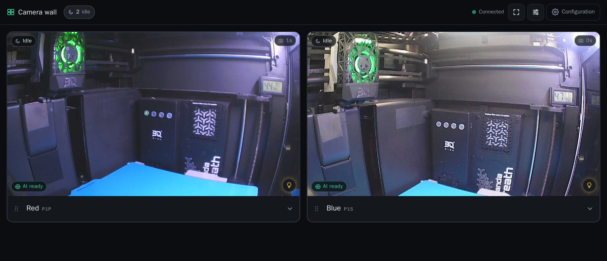

# bambu-mqtt-proxy

[](https://github.com/bradsjm/bambu-mqtt-proxy/actions/workflows/ci.yml)
[](https://github.com/bradsjm/bambu-mqtt-proxy/actions/workflows/docker-publish.yml)

[](LICENSE)

One MQTT endpoint for every Bambu Lab printer in your home. Bambu printers
tolerate only a handful of MQTT connections (~4 on P1/X1, a single one on A1),
and every app you point at a printer — Bambu Studio, Home Assistant, xtouch,
OctoPrint plugins — burns one of those slots. This small, stateless proxy poses
as the printer: your apps connect to it exactly as they would to the printer
(same port, `bblp` + access code, self-signed TLS), and it holds **one**
always-on upstream connection per printer from boot, routed by the serial
number in the Bambu topic path.

```
 Bambu Studio   Home Assistant   xtouch   ...        (≈10+ TLS clients)
      │               │             │
      └───────────────┼─────────────┘
                      ▼
        ┌──────────────────────────────┐
        │  bambu-mqtt-proxy            │
        │  TLS :8883 (self-signed)     │
        │  TLS :6000 raw camera        │
        │  serial → upstream table     │
        └───┬──────────────┬───────────┘
            │ 1 conn       │ 1 conn
            ▼              ▼
      P1S :8883        X1 :8883
```

Each printer link subscribes once to `device/{serial}/report` on every
connect, then requests one full state with `pushall`. Reports flow to every
subscribed client and into the proxy's merged per-printer state, which feeds
the camera wall, MCP, and the optional modules.

| What you get | Why it matters |
|---|---|
| **Apps work unchanged** | Same port 8883, `bblp` username, printer access code, skipped certificate verification; payloads forwarded byte-for-byte (compatible with 2025+ signed-firmware printers). |
| **Printer connection limits stop mattering** | Any number of clients share one always-on link per printer. |
| **One endpoint for the whole fleet** | MQTT topics route by serial (`device/{serial}/report`, `device/{serial}/request`); only raw camera connections route by access code instead. |
| **Optional Pushover notifications** | Print errors, HMS warnings, AI detection alerts, stopped or failed prints, and completions reach one Pushover account, with a camera snapshot when available. |
| **Optional over-temperature stop** | A backup to the printer's own thermal protection: a nozzle, bed, or chamber reading at its model's safety limit stops every printer, switches that printer's Panda PWR off, and sends a Pushover emergency alert. |
| **Printer outages ride out** | Automatic reconnect and resubscribe with a `pushall` warmup. A client that joins late sends its own `pushall` when it needs full state (P1 printers otherwise send deltas only). |
| **Cameras, two ways** | A live multi-printer dashboard wall — P1/A1 cameras natively, X1/P2S/H2-series cameras through bundled FFmpeg — and a printer-compatible raw passthrough on port 6000. |
| **Optional AI failure detection** | With an OctoEverywhere Gadget key, snapshots from active prints are analyzed and the proxy pauses likely failures. No key, no uploads, no automatic pauses. |
| **Optional build-plate check** | With a vision provider (Cloudflare or a custom HTTPS endpoint) and key, one fresh snapshot is checked at print startup and the proxy sends `stop` when the plate looks occupied. A built-in first-layer phase then uploads two frames and may pause once for a tangled filament, a detached part, or a nozzle blob. Best effort, fail-open, and off without both. |
| **MCP endpoint** | `/mcp` exposes printer state, camera snapshots, and printer controls (pause, resume, emergency stop, chamber light, speed profile, AI monitoring toggle) to AI agents. |
| **Supervision-friendly** | `/livez`, `/readyz`, and `/status` for Docker/Kubernetes probes. |
| **Stateless and multi-arch** | No database, no volumes required; `linux/amd64` and `linux/arm64` images. |

## Quick start

Prerequisites:

1. Enable **LAN Mode** on each printer (Settings → Network → LAN Mode). Current
   firmware also requires **Developer Mode** for control commands such as pause.
2. Note each printer's access code and IP address.

### 1. Start the proxy

**Docker, configure in the browser (recommended)**

```sh
docker run -d --name bambu-mqtt-proxy -p 8883:8883 -p 6000:6000 -p 8080:8080 \
  -v bambu-mqtt-proxy:/config \
  ghcr.io/bradsjm/bambu-mqtt-proxy:latest
```

Open `http://<host>:8080/config`, add your printers, and choose **Save and
apply**. No config file is needed to start: until a printer is configured the
proxy serves only the HTTP health and configuration endpoints, and saving
creates `/config/bambu-mqtt-proxy.yaml` and restarts the proxy with the new
settings. Prefer a bind mount? Use `-v $(pwd)/config:/config`; add `:ro` to
lock the configuration — saving then fails and leaves the running settings
unchanged.

**Docker, with a configuration file**

Copy [`config.example.yaml`](config.example.yaml) to `./config/bambu-mqtt-proxy.yaml`,
fill in your printers, and mount the directory:

```sh
mkdir -p config
cp config.example.yaml config/bambu-mqtt-proxy.yaml   # then fill in your printers
docker run -d --name bambu-mqtt-proxy -p 8883:8883 -p 6000:6000 -p 8080:8080 \
  -v ./config:/config \
  ghcr.io/bradsjm/bambu-mqtt-proxy:latest
```

One printer entry looks like this:

```yaml
printers:
  - serial: "01P00A123456789"
    name: "Garage P1S" # optional friendly label for the camera wall; never used for routing
    address: "192.168.1.42:8883"
    tls: true
    insecure_skip_verify: true
    username: "bblp"
    password: "12345678"
```

MQTT always routes by serial, or by the optional `alias` when one is set (see
[Configuration](#configuration)); the `name` label only decorates the camera wall.
Mount the config directory, not the file: a save replaces the file atomically,
and a single-file mount cannot be replaced.

**Docker Compose**

```sh
cp compose.example.yaml compose.yaml   # then fill in your printers
docker compose up -d
```

**From source**

```sh
scripts/setup-toolchain.sh               # installs the Go version pinned by go.mod
go build -o bambu-mqtt-proxy ./cmd/bambu-mqtt-proxy
./bambu-mqtt-proxy -config bambu-mqtt-proxy.yaml
```

### 2. Point your apps at the proxy

| Your app | Connect to | Username | Password |
|---|---|---|---|
| MQTT clients — Bambu Studio, Home Assistant, xtouch, OctoPrint plugins | `<proxy-host>:8883` | `bblp` | any configured printer's access code |
| Camera apps speaking the printer camera protocol | `<proxy-host>:6000` | `bblp` | the target printer's access code |

MQTT traffic carries the serial (or the printer's alias, when set) in its
topics, so one endpoint serves every configured printer. Camera connections
carry no serial: the access code selects the printer, so give each printer a
unique access code (the proxy does not reject duplicates, and MQTT routing is
unaffected).

## Configuration

The YAML file is the configuration. Only two environment variables override
it: `BMBPX_HTTP_PORT` overrides `http.port`, and `BMBPX_LOG_LEVEL` overrides
`log.level`.

| Source | Best for |
|---|---|
| [`/config`](#configuration-page-config) web page | Adding or editing printers in a browser |
| YAML file | Full control over listeners, TLS, and optional features — see [`config.example.yaml`](config.example.yaml) and [DESIGN.md §9](DESIGN.md) for the full reference |

```yaml
listen:
  - port: 8883
    tls: true
    cert_file: ./certs/proxy.crt   # generated on first start if missing
    key_file: ./certs/proxy.key
auth:
  mode: printer                    # require bblp + a configured access code
printers:
  - serial: "01P00A123456789"
    address: "192.168.1.42:8883"
    tls: true
    insecure_skip_verify: true
    username: "bblp"
    password: "12345678"
  - serial: "01S00C351100139"
    name: "Garage P1S"               # optional friendly label for the camera wall; never used for routing
    model: "P1S"                     # optional; camera support is auto-detected from the serial prefix
    address: "192.168.1.42:8883"
    tls: true
    insecure_skip_verify: true
    username: "bblp"
    password: "87654321"
http:
  port: 8080                         # 0 means unset: the proxy uses 8080 and logs a warning
camera:
  enabled: true                      # false removes camera routes, the camera wall, and the raw camera listener on port 6000
mcp:
  enabled: true                      # default; set false to remove the MCP endpoint at /mcp
notifications:
  enabled: false                     # optional Pushover print alerts; see below
  provider: pushover
  pushover:
    app_token: ""                    # from pushover.net
    user_key: ""
safety:
  enabled: false                     # optional over-temperature stop; also a switch on /config
log:
  level: info
```

| Environment variable | Default | Meaning |
|---|---|---|
| `BMBPX_LOG_LEVEL` | *(unset)* | A non-empty value overrides `log.level`: `info` logs client and upstream state, subscriptions, and retries; `debug` adds per-packet request routing, raw printer reports, every activity entry, and each plate-check, first-layer, AI detection, and job-preview (3MF) decision with scores, timings, and outcome |
| `BMBPX_HTTP_PORT` | *(unset)* | A value from 0 to 65535 overrides `http.port`: the shared health, camera, and MCP HTTP port; `0` means unset (8080) |

An optional per-printer `alias` is a replacement serial seen only by
downstream MQTT clients, so a printer can be swapped without reconfiguring
downstream apps. Either generate an alias in advance and point apps at it
once, or after a swap set `serial` to the new printer and `alias` to the old
serial so existing apps keep working. The `/config` page offers a Generate
button that makes a serial-shaped value with the printer model's prefix; the
value stays editable. Aliases allow uppercase letters and digits only and
must be unique across all configured serials and aliases. Only the serial is
replaced: the new printer's access code still applies, and some report
payloads still carry the real serial because payloads are forwarded
unchanged. Camera endpoints, `/status`, `/activity`, and MCP keep using the
real serial.

## HTTP endpoints

Health, camera, and MCP endpoints share one listener, always on (port 8080 by
default). When cameras are disabled only the health, `/config`, activity, and
MCP endpoints (unless disabled) are served.

| Endpoint | Purpose |
|---|---|
| `/` | Redirects to `/config` in setup mode, otherwise to `/camwall` |
| `/livez`, `/readyz` | `200 ok` once serving (printer state deliberately excluded — clients stay connected while printers recover) |
| `/status` | JSON: `{"status":"ok","upstreams":{"<serial>":true\|false}}`, plus `detection` and `platecheck` sections when those modules run |
| `POST /platecheck/snapshots` | Plate-check dry run used by the `/config` page: checks one fresh snapshot per online, camera-capable printer in parallel and streams the exact images and scores as NDJSON (`start`, one `result` per printer, `done`). Offline printers are skipped. Sends no printer command. Covers the startup check only, not the first-layer phase. Mounted when cameras are on |
| `/activity`, `/activity/{serial}` | Up to 50 recent per-printer events (in memory; cleared when the proxy restarts); alert and error entries can carry a `url` with an error-code lookup link |
| `/camera/{serial}/snapshot` | Single JPEG frame (P1/A1 native; X1/P2S/H2-series converted server-side with FFmpeg) |
| `/camera/{serial}/stream` | Live multipart MJPEG stream (same model support as the snapshot) |
| `/camera/{serial}/preview` | Archived plate render of the running print, fetched once per job over FTPS |
| `/camera/status` | Display state for every printer (no credentials), polled by the wall every second |
| `/camwall` | Multi-printer camera wall dashboard |
| `/config`, `/config/api` | Browser configuration page and its JSON API (`GET` never returns access codes; `PUT` saves and restarts the proxy) |
| `/favicon.ico`, `/apple-touch-icon.png` | Browser-tab, bookmark, and home-screen icons |
| `/mcp` | Model Context Protocol endpoint (off with `mcp.enabled: false`) |
| `/control/{serial}` | Printer control from the camera wall: `POST` `{"action":"light\|pause\|resume\|speed\|stop"}` (see below) |

### Camera wall

Open `http://<host>:8080/camwall`.



- **Controls** — each tile carries buttons for chamber light, pause/resume,
  and emergency stop, plus a speed-profile selector. They `POST` to
  `/control/{serial}` with a JSON body:

  ```json
  {"action": "light|pause|resume|speed|stop", "on": true, "profile": "silent|standard|sport|ludicrous"}
  ```

  `on` is required for `light`; `profile` is required for `speed`. Responses:
  `200` `{"serial":"...","action":"...","sent":true}`; `400` invalid body,
  unknown action, missing `on`, or bad profile; `404` unknown printer;
  `502` the command could not be sent; `503` the printer is not connected. Errors
  return `{"error":"..."}`. There is no authentication and no confirmation;
  stop is the emergency stop and sends immediately.

- **Tiles** pair each camera with color-coded print state, a progress edge,
  and a headline progress/time-left figure. Print errors and HMS alerts appear
  as a severity-colored banner with a suggested fix, resolved from the
  [PrintARA Bambu error code database](https://printara3d.com/tools/bambu-error-codes/).
- **Detail levels** — click a tile's details panel to step through compact,
  vitals (layer count, finish time, nozzle/bed/chamber temperature gauges),
  and full details. Full details add the recent activity log (up to 50
  entries per printer: print state changes, alerts with the same
  descriptions as the live alert banner, connectivity, AI detection events).
  Alert and error entries can carry a `Look up` link to the error-code
  reference. The log is held in memory and starts empty after each proxy
  restart.
- **Fleet chips** in the top bar count printers per state and double as
  filters; **needs attention** collects failed, paused, and
  serious-alert printers, plus detection warnings or pause attempts when the
  Gadget integration is on.
- **Layout** — click a camera to focus it full-width; drag the grip (or use
  the arrow keys when focused) to reorder tiles. Tiles resize to the window,
  from one column on phones to a grid on wall displays.
- **Live streams** — focused cameras and active prints (running or paused)
  hold live streams, up to four visible, connected printers by default. Other
  visible tiles use snapshots; background tabs and disconnected printers hold
  no camera connection.
- **Settings** — the dialog sets the live-stream cap (1–16), snapshot refresh
  interval (2–60 s), tile size, and detail level, plus a keep-screen-awake
  option. Order, filters, and settings persist in that browser's local storage
  only; the proxy stores no wall state.
- **URL parameters** — `?kiosk=1` hides the top bar and always requests a
  screen wake lock; `?maxLive=` and `?interval=` override stored stream
  settings. Browsers grant wake locks only on HTTPS or `localhost`, and over
  plain HTTP they allow about six connections per host, shared by live
  streams and snapshots.
- **State source** — the wall polls `/camera/status` every second while
  visible. Liveness is the upstream MQTT connection state
  (`freshness.fresh`): a connected printer stays live through report gaps,
  and `freshness.last_report_age_seconds` is diagnostic only. A disconnected
  printer shows as offline.
- **Stateless privacy** — camera and camera-wall endpoints are unauthenticated
  by design: anyone who can reach the HTTP port can view cameras and
  telemetry. The state endpoints never include credentials.

Camera capture is automatic for configured printers: the model is detected
from the serial prefix, so no per-printer configuration is required. Two
transports exist:

| Model | Serial prefix | Web transport |
|---|---|---|
| P1P | `01P` | Native chamber JPEG protocol |
| P1S | `01S` | Native chamber JPEG protocol |
| A1 MINI | `030` | Native chamber JPEG protocol |
| A1 | `039` | Native chamber JPEG protocol |
| X1 | `00W` | RTSPS, converted server-side with FFmpeg |
| X1C | `00M` | RTSPS, converted server-side with FFmpeg |
| X1E | `03W` | RTSPS, converted server-side with FFmpeg |
| P2S | `22E` | RTSPS, converted server-side with FFmpeg |
| H2S | `093` | RTSPS, converted server-side with FFmpeg |
| H2D | `094` | RTSPS, converted server-side with FFmpeg |

For RTSPS models the proxy pulls `rtsps://<printer>:322/streaming/live/1`
with the printer's `bblp` access code and converts the video to JPEG frames
for the wall at a fixed low rate. H2-series firmware may need
**Settings → LAN Mode Liveview** enabled on the printer for port 322 to
answer. The Docker images bundle FFmpeg, so no extra setup is needed there;
a native install needs `ffmpeg` on `PATH`. Without it, RTSPS models show
"camera unavailable: FFmpeg is not installed" on the wall, one warning is
logged at startup, and P1/A1 cameras keep working — install FFmpeg and
restart the proxy to enable them.

An explicit `model` field overrides the inference. Ineligible serials
(unsupported models, unknown prefixes) answer `404` (unknown serial) or
`422` (unsupported model) without ever opening a camera socket. The Gadget AI
detection feature covers only the P1/A1 chamber-protocol models. Chamber
temperature is shown only for models with a physical chamber sensor (the
X1/X2/P2/H2 classes); P1 and A1 models omit the reading even if their report
contains `chamber_temper`.

### Raw camera passthrough (port 6000)

- TLS listener speaking the printer's own camera protocol: the client sends
  the printer's 80-byte `bblp` + access-code authentication and receives the
  printer's native JPEG frame flow unchanged.
- Serves the chamber-protocol models (P1/A1) only; X1/P2S/H2-series cameras
  are not proxied on this port.
- Starts with the camera feature, and a port or
  certificate failure fails startup with a wrapped error.
- The access code is the routing key, so printers need unique access codes for
  raw camera clients to reach the right printer (see [Quick start](#2-point-your-apps-at-the-proxy)).

### MCP endpoint (`/mcp`)

On by default; disable with `mcp.enabled: false`. MCP protocol
2026-07-28 over Streamable HTTP, tools only:

- **Core read-only tools** — `list_printers`, `get_printer_state`,
  `get_camera_snapshot`, and `watch_printer` (long-polls the activity log:
  pass `after_id` from the previous answer, and the call returns newer
  entries with the current state).
- **Core control tools** — `pause_print`, `resume_print`, `stop_print` (a
  destructive emergency stop with no confirmation), `set_chamber_light`,
  and `set_speed_profile`.
- **Module tools**, served by their modules when those modules run:
  `set_ai_monitoring` with the Gadget AI detection (which also needs the
  camera feature), and `get_job_preview` with the job preview feature. The
  endpoint has no resources, subscriptions, revisions, or cursors.
- **Printer state** — `get_printer_state` and `watch_printer` return
  `state.modules.<name>` per running module (for example
  `state.modules.jobpreview` with the archived job preview,
  `state.modules.pandabreath` with the device `link`, its fresh
  `chamber_c` reading, and the `trend` and signed `rate_c_per_min`, or
  `state.modules.pandapwr` with the device `link` and its fresh
  `power_w` in watts; Panda PWR has no MCP tool), so
  one tool stays current whatever capabilities are enabled.
- The endpoint never learns printer credentials; control commands go through
  the same allow-listed command service as the camera wall.

### Configuration page (`/config`)

- Edits the YAML config file (the `-config` path, default
  `bambu-mqtt-proxy.yaml`). Saving validates the settings, writes the file
  (created along with its directory when missing), then restarts the proxy
  process with the new settings; MQTT clients reconnect as they would after a
  proxy restart, and the page waits for the new process. Saving requires a
  writable directory mount — a single-file bind mount cannot be replaced
  atomically, so the save fails with the remedy. If the saved settings fail
  to start (for example a port already in use), only health and `/config`
  serve, with the error shown on the page.
- Never displays or returns access codes: a blank code keeps the stored one,
  and changing a printer's address requires entering its code again.
- Edits each printer's optional `alias`. A Generate button fills a
  serial-shaped value using the model's prefix; you can edit it before saving.
- Marks the HTTP port and the log level when `BMBPX_HTTP_PORT` or
  `BMBPX_LOG_LEVEL` is set; those variables still win. Saving rewrites the
  file, so comments in it are not kept.
- Handles Pushover credentials the same way in the Notifications section:
  they are never displayed or returned, a blank field keeps the stored
  value, and **Send test notification** sends one test message without
  saving.
- Toggles the over-temperature safety stop in the Safety section.

## Build-plate check (optional)

The `platecheck` section (editable on the `/config` page) checks the build
plate when a print starts. Set `provider` (`cloudflare`, the default, or `custom`). Cloudflare needs
`account_id` (32 hexadecimal characters), `api_key`, and `model` (`clef` or
`clef-flash`); the proxy builds the Workers AI URL. Custom needs `endpoint` (a
full HTTPS URL that accepts the same request and answer format), `api_key`, and
a free-text `model`. Also set `stop_confidence` (0.50 to 0.99 in 0.01 steps, default
0.50). The nested `first_layer` section controls the first-layer phase: it is on
whenever the plate check is on, `first_layer.enabled: false` disables that phase
alone, and `first_layer.pause_confidence` (0.50 to 0.99 in 0.01 steps, default
0.70) is its pause cutoff. Without an explicit `enabled`, the check runs when the
provider target and key are set. The key is write-only on the page, a blank value
keeps the stored key, and a stored key is never sent to a different account or
endpoint than the one it belongs to.

For each new print job, the startup check runs in two passes. Pass 1 checks at
PREPARE (or at RUNNING layer 0), when the bed may still sit lowered and out of
camera view. Pass 2 checks again after the toolhead homes: once the printer
has reported stage (`stg_cur`) 13 or 14 during the job, it checks at RUNNING
layer 0. Bed leveling (stage 1) is not a trigger, because leveling is optional
per job. Each pass waits for a fresh camera frame, may turn the chamber light
on, uploads that one JPEG to the endpoint, and sends `stop` only when the
model is sure the view is usable (assessable at least 0.8) and the occupied
probability is above `stop_confidence`. The startup check does not pause or
resume prints during startup. Every failure, unclear image, or missing camera
lets the print continue. A print already underway when the proxy starts is
never stopped — the panel says `Proxy started after this print began`. Skip and
failure entries use plain-English reasons (for example `Plate check skipped,
printer offline, no stop sent, continuing print`); pass 2 entries use the
check name `Plate check after homing`. A stop sent during PREPARE is repeated
once when the job first reaches RUNNING. Each new print job starts with the
previous job's plate-check and first-layer findings cleared.

### Startup decision

The model returns two probabilities for the snapshot, and the proxy combines
them into one of three outcomes:

| Outcome | Condition | Result |
|---|---|---|
| **Stop** | `assessable` ≥ 0.8 **and** `occupied` > `stop_confidence` | The proxy sends one `stop` and records it in the activity log. |
| **Unclear** | `assessable` < 0.8 (blocked view, dark chamber, bad angle) | The print continues; the result is recorded. |
| **Clear** | `assessable` ≥ 0.8 **and** `occupied` ≤ `stop_confidence` | The print continues. |

Raise `stop_confidence` to avoid false stops; lower it to catch more objects
on the plate. Any error, timeout, or missing camera is treated like an unclear
result: the print is never stopped on a failure.

### First-layer check

The first-layer phase uses the same provider, credential, and model as the
startup check. For each print job, once the layer count rises from 1 or below
to 2 or above while the print is still running, the proxy uploads two fresh
original JPEGs taken at least 2 seconds apart, in one request. The model
answers five questions:

| Question | Effect |
|---|---|
| Is the view usable (`assessable` ≥ 0.8)? | Below 0.8 the check is inconclusive. |
| Is the filament tangled? | Pause-capable. |
| Is a part visibly detached? | Pause-capable. |
| Is there a nozzle blob at millimeter scale? | Pause-capable. |
| Is the layer incomplete or material missing? | Warning only. |

With a usable view, any pause-capable probability strictly above
`pause_confidence` sends one `pause`. The proxy sends no second pause and
never resumes the print. Otherwise, any defect probability above 0.5 records
a warning, and a check with no such defect passes. An inconclusive view, an
error, a timeout, or a missing camera fails open: the print continues. The
phase checks each job at most once.

### Cloudflare free allowance

Cloudflare Workers AI gives every account 10,000 neurons per day at no charge,
reset at 00:00 UTC. At list price that allowance is worth about $0.11 a day.
With both phases on, one print uploads three frames in two requests: the
startup check and one first-layer request that carries two images. The counts
below size the allowance in single-image requests, and a two-image first-layer
request consumes more input tokens than one of them:

| Model | Free input tokens per day | Single-image requests per day (about 500 tokens each) |
|---|---|---|
| `clef` | about 458,000 | roughly 900 |
| `clef-flash` | about 1.22 million | roughly 2,400 |

Even so, the daily allowance covers far more prints than a typical home printer
starts in a day. See
[Workers AI pricing](https://developers.cloudflare.com/workers-ai/platform/pricing/)
for current rates. Dry runs from the `/config` page count against the same
allowance.

This is a best-effort check, not a collision interlock. Slicers connect to the
printer directly, so the print may already be moving when the stop arrives, and
the printer may refuse the command. Stop requests, first-layer warnings, and
first-layer pause attempts — including failed or unconfirmed pauses — go to the
activity log and, with notifications on, to Pushover; first-layer passes,
confirmed pauses, and skips stay in the activity log. The camera wall shows a
`Print checks` panel covering both phases, with a `Before printing` section
(plate state, rule, scores) and an `After layer 1` section (first-layer state,
rule, view clarity, findings); skips and failures name the reason in a note
(for example `Printer offline; no stop sent`).

Chamber cameras look across the plate from one corner, so a tangle, a blob, or
a detached part can be hidden behind the toolhead or the part itself, and small
features sit near the resolution limit. The defect thresholds are unverified
model calibration, not a measured specification; treat every result as
advisory.

The `/config` page has a `Test plate check` button. It checks the key and then
uploads one current snapshot from each camera to the endpoint, showing each image
and its scores. It saves nothing and sends no printer command. It needs the
camera feature. Camera snapshots leave your LAN when you use it or enable the
check.

## Gadget AI print-failure detection (optional)

Detection is configured in the `detection` section of the config file
(editable on the `/config` page): `enabled` switches the feature, and
`api_key` stores an
[OctoEverywhere Gadget API key](https://octoeverywhere.com/gadgetapi)
([API documentation](https://docs.octoeverywhere.com/ai-failure-detection-apis/overview/)).
The stored key never leaves the server: the configuration API reports only
whether a key exists, a blank value on save keeps the stored key, and the
config file is written with owner-only permissions. Without an
explicit `enabled`, detection follows the key: it runs when a key is
configured and stays off otherwise. `enabled: false` disables the feature
even when a key exists, and enabling without any key fails validation. The
key cannot be removed from the page — use the switch. There is no usage
bookkeeping; the proxy stays stateless.

While a print is active on a camera-capable printer, the proxy uploads the
current camera snapshot to the Gadget service at the pace the service directs
and receives a print-quality score (1–10) plus warning and pause
recommendations:

- Warnings surface per printer as a `detection` object on `/camera/status`
  and `/status`; each object's `state` — starting, idle, monitoring,
  attention, paused, degraded, unsupported, blocked, or disabled — shows at
  a glance what detection is doing for that printer.
- A pause recommendation sends a single LAN `pause` command. Each
  recommendation pauses at most once; the proxy never retries a pause and
  never resumes the print.
- The AI badge on a camera wall tile toggles detection for that printer.

**Consent.** Enabling detection with a key is an explicit opt-in to the
service: camera snapshots leave your LAN for OctoEverywhere's servers, and the
proxy can pause prints without asking. Leave the key unset to keep every image
local and automatic printer controls off.
**Eligibility.** Detection rides on the camera pipeline, so it covers exactly
the camera-capable models (P1P, P1S, A1, A1MINI) and only while the printer
reports a print actively running and the upstream connection is live. It
requires the camera feature (`camera.enabled`): with cameras disabled and a
key set, nothing runs and every printer's `detection` object reports
`blocked`. The wall text for `awaiting_reports` is `awaiting printer
reports`: it means waiting for printer data, not a timer.

**Allowance.** Enforcement lives entirely on OctoEverywhere's side. Each
account includes 90,000 free inspection calls per monthly billing period —
about 500 print hours at the 20-second cadence the pricing assumes, about 125
hours if the service directs 5-second inspections — and the allowance is
shared across the whole account: the same key in any other printer, tool, or
proxy instance consumes the same budget. Accounts default to **Free Usage
Only**, so inspections stop at the allowance instead of incurring charges.

**Failures and limits.**

- Network errors, timeouts, server errors, and rate limits degrade detection
  and retry at the service-directed pace, never affecting printing or camera
  serving. The first failure records `AI inspection interrupted, <reason>` in
  the activity log, and recovery records `AI inspection recovered`.
- Invalid or disabled keys, billing failures, IP restrictions, and exhausted
  free allowances suspend detection until restart; account errors suspend it
  across all printers. Logs show safe, structured reasons, not provider error
  text.
- Monitoring is per-print and advisory — these are heuristics, not a guarantee
  of failure detection. Pausing needs a printer that accepts LAN commands
  (Developer Mode on 2025+ signed firmware, as for any client).
- Results and policy timing stay in memory; a restart clears
  every status and context.

## Pushover notifications (optional)

Enable the Notifications section on `/config` (or the `notifications` YAML
block) to send print alerts to one [Pushover](https://pushover.net/) account.

- **What notifies** — a print finishing, failing, being cancelled, or stopping
  before it finishes; printer errors and HMS warnings; AI detection warnings
  and AI pause attempts, including failed or unconfirmed ones; a build-plate
  check that requests a startup stop, or a first-layer warning or pause
  attempt, including failed or unconfirmed first-layer pauses; the first layer
  completing; and a pause that leaves an active printer alert. Starts,
  resumes, reconnects, cleared alerts, and routine plate-check entries
  (first-layer passes, confirmed pauses, and skips) do not notify.
- **What arrives** — events within 2 seconds group into one message per
  printer: the event summaries, the running file, and each active alert with
  its error code and suggested fix. The title is the printer's name or
  serial. A camera snapshot attaches when one is available.
- **Setup** — create a Pushover application for the app token, enter both
  values on `/config`, save, and use **Send test notification**. Pushover
  messages arrive from your own application, so you can filter them.
- **Delivery is best-effort** — one attempt per message, no retry queue, and
  nothing is stored; a busy queue or failed delivery logs a warning and the
  proxy moves on. A restart may repeat one active alert.
- **Privacy** — enabling this sends print metadata (event text, file name,
  error codes) and, when a camera is available, camera frames to Pushover's
  servers. Leave notifications disabled to keep everything local.

## Over-temperature safety stop (optional)

Turn on the Safety switch on `/config` (or set `safety.enabled: true` in the
YAML file) to add a best-effort backup to the printer's own thermal
protection. It needs the Pushover app token and user key in the
`notifications` section, even while ordinary notifications are off.

- **What trips** — the proxy checks every connected printer once per second.
  A nozzle, bed, or chamber reading at or above the model's limit trips. The
  chamber uses the printer's own sensor, or the latest Panda Breath reading on
  models without one.

  | Model | Nozzle | Bed | Chamber |
  |---|---|---|---|
  | A1 mini | 320 °C | 95 °C | 80 °C |
  | A1, P1P, P1S | 320 °C | 115 °C | 80 °C |
  | X1, X1C, P2S | 320 °C | 125 °C | 80 °C |
  | X1E | 340 °C | 135 °C | 80 °C |
  | H2D, H2D Pro, H2S, H2C, X2D, and unknown models | 370 °C | 135 °C | 80 °C |

- **What happens** — one `stop` command to every printer, one Panda PWR
  power-off (`POST /set power=0`) to the printer that tripped when it has
  `panda_pwr` set, and one Pushover emergency alert that repeats every 30
  seconds for up to an hour until acknowledged. The alert lists any stop or
  power-off that failed. Each action is one attempt, with no retry or
  confirmation.
- **Re-arming** — a printer responds once per episode and re-arms when all its
  readings are below the limits again.
- **Limits** — the proxy cannot act on a printer that stops reporting, and a
  fire that does not raise these temperatures goes unseen. Keep a smoke
  detector.

## Breaking changes

- MCP: the `bambu://printers/{serial}/state` resource and subscriptions are
  gone, as are `watch_printer` modes (`attention`, `progress`), revisions,
  and cursors. Tools only; `watch_printer` takes `after_id`.
- Config: the `behavior` section is gone; old keys load but are ignored.
- Config: `http.port: 0` no longer disables HTTP. It means unset: the proxy
  serves HTTP on 8080 and logs a warning.
- HTTP: `/camera/events` is removed. Poll `/camera/status`.

## Security notes

- Runs as a non-root user in the container. The config file contains printer
  access codes and, when notifications are configured, the Pushover app token
  and user key — protect it accordingly, and never commit
  `bambu-mqtt-proxy.yaml`.
- TLS certificates are unverified on both hops, matching Bambu's own LAN
  protocol; the proxy is intended for trusted home LANs.
- The camera endpoints, `/mcp`, and the `/config` page are unauthenticated:
  anyone who can reach the HTTP port can view cameras and printer state,
  fetch snapshots, and change settings (though never read access codes, or
  send a stored code to a new address). The camera wall's
  `POST /control/{serial}` and the MCP control tools can also pause, resume,
  change speed, toggle the chamber light, and **emergency-stop** prints
  without login; heater and temperature commands are never exposed. Browser
  requests from other sites are rejected. Set `mcp.enabled: false` or mount
  the config directory read-only to narrow the surface.
- The raw camera endpoint on port 6000 authenticates with `bblp` plus a
  configured printer access code; the code selects the printer.
- The OctoEverywhere key is a secret: the configuration API never returns it
  and the config file stores it with owner-only permissions — share
  the account with caution, because the key authorizes external snapshot
  uploads and automatic pauses, and usage is billed per OctoEverywhere
  account, not per proxy.

## Development

```sh
go test -race -p 1 ./...      # unit + fake-printer integration suite
go build ./cmd/bambu-mqtt-proxy
docker buildx build --platform linux/amd64,linux/arm64 -t bambu-mqtt-proxy .
```

`tools/capturereports` extracts printer-report replay fixtures from proxy
container logs:

```sh
docker logs bambu-mqtt-proxy 2>&1 | go run ./tools/capturereports -serial <serial> -out internal/printer/testdata/live_<serial>_<yyyymmdd>
```

It keeps the `printer report received` lines for exactly that serial, starts a
new segment at each `mochi mqtt server started` line, and writes one
`<prefix>_<n>.jsonl` file per non-empty segment (`t_ms`, connection `gen`,
`payload` per line), which `go test -race -run Replay ./internal/printer/`
replays.

## License

[MIT](LICENSE)
